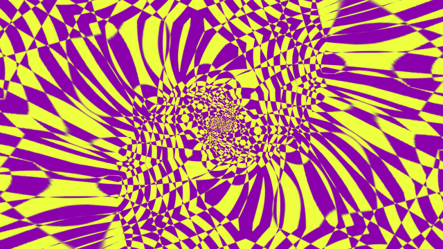
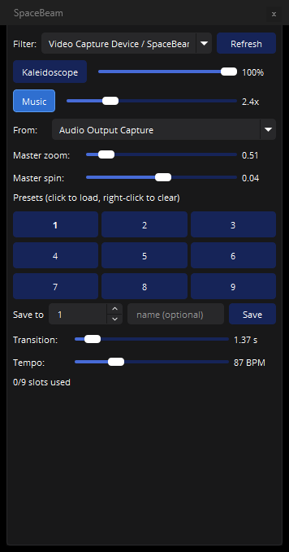

# SpaceBeam for OBS


Native OBS Studio filter plugin ported from the [SpaceBeam](https://github.com/CalmyJane/SpaceBeam)
Android app by Calmy Jane.



> **License: GPL-3.0.** This is a derivative work of SpaceBeam's shaders, which are
> GPL-3.0. Any binary or fork you distribute must remain GPL-3.0.

> **Runs on Windows, Linux and macOS.** Windows has an installer and the
> `*.ps1` build scripts. Linux has a prebuilt archive and builds with
> `./build.sh`. macOS builds from source — see
> [docs/BUILDING-UNIX.md](docs/BUILDING-UNIX.md).

## The control dock



Preset pads, transition time and tempo without opening the properties dialog.
See [Dock panel](#dock-panel).

## What it does

Adds a **SpaceBeam** video filter that runs SpaceBeam's effect chain on any source:

```
Mixer (4 layers) + frame feedback
  -> Camera Transform
  -> Color
  -> Edge Detect
  -> Kaleidoscope
  -> Droste (Escher spiral)
  -> Master Transform
  -> 3D Tunnel
  -> Swirl (raymarched gyroid)
```

Each stage has its own set of sliders in the filter properties. Stages that are
visually inert (amount 0, or defaults) are skipped and cost no GPU time.

On top of the source chain it adds **9 morphing presets**, **4 tempo-syncable
LFOs**, and a **4-layer multi-source mixer** — described below.

## Installing (no build)

### Which file do I download?

Every asset name is **platform-tagged**, so the right one is unambiguous. From the
[releases page](https://github.com/KoBadger/spacebeam-obs/releases/latest):

| Your OS | File | Notes |
|---|---|---|
| 🪟 **Windows x64** | `SpaceBeam-<version>-windows-x64-setup.exe` | Installer (recommended). All users, clean uninstall. |
| 🪟 **Windows x64** | `spacebeam-<version>-windows-x64.zip` | Manual: extract into `C:\ProgramData\obs-studio\plugins\` |
| 🐧 **Linux x64** | `spacebeam-<version>-linux-x64.zip` | Extract into `~/.config/obs-studio/plugins/` |
| 🍎 **macOS** | *no binary yet* | Build from source — see [docs/BUILDING-UNIX.md](docs/BUILDING-UNIX.md) |

Each archive ships with a `.sha256` beside it.

> **No iOS, Android or phone build.** OBS Studio does not run on phones, so
> there is nothing to install there and no phone download exists. The original
> [SpaceBeam Android app](https://github.com/CalmyJane/SpaceBeam) is a separate
> project — that is the one for Android.

### Windows

**Installer (recommended).** Run `SpaceBeam-<version>-windows-x64-setup.exe`. It
installs for all users, upgrades over older versions and uninstalls cleanly.

**Manual.** Download `spacebeam-<version>-windows-x64.zip`, extract it into
`C:\ProgramData\obs-studio\plugins\` so you end up with
`C:\ProgramData\obs-studio\plugins\spacebeam\bin\64bit\spacebeam.dll`, then
start OBS.

To remove it, uninstall from Windows Settings, or delete that `spacebeam`
folder.

### Linux

Download `spacebeam-<version>-linux-x64.zip` and extract it into OBS's per-user
plugin directory, so you end up with
`~/.config/obs-studio/plugins/spacebeam/bin/64bit/spacebeam.so`:

```bash
unzip -o spacebeam-<version>-linux-x64.zip -d ~/.config/obs-studio/plugins/
```

Then restart OBS. `./install.sh --user` does the same thing from a local build;
`docs/BUILDING-UNIX.md` covers building it yourself.

### macOS

No prebuilt binary yet: there is no libobs development package for macOS, so it
has to be built from source — [docs/BUILDING-UNIX.md](docs/BUILDING-UNIX.md)
walks through it.

> **Upgrading from 1.1.x or earlier?** Those versions kept the DLLs in the
> plugin folder itself. Delete `C:\ProgramData\obs-studio\plugins\spacebeam`
> before extracting, otherwise OBS finds two copies of the plugin and lists
> the filter twice. `.\install.ps1` cleans the old files for you.

## Quick start

1. Right-click any source -> **Filters** -> **+** -> **SpaceBeam**.
2. Open **Kaleidoscope**, set **Axis** to 6 and **Amount** to 1.0.
3. That's the classic SpaceBeam look. Everything else is additive.

## What was ported, what was not

| SpaceBeam feature | Status in this port |
| --- | --- |
| Kaleidoscope, Droste, 3D Tunnel, Swirl, Color, Edge Detect | Ported (GLSL ES -> OBS HLSL effect) |
| Camera Transform / Master Transform | Ported (incl. RGB shift, wobble, bend) |
| Frame feedback loop with tap points + blend modes | Ported, internal to the filter |
| Presets, smooth transitions | **Ported** — 9 slots, animated morphing |
| LFOs, BPM sync | **Ported** — 4 LFOs, 5 waveforms, tempo-locked or free-run |
| MIDI mapping | **Not yet** — bind a MIDI-to-hotkey bridge to the preset hotkeys |
| Audio reactivity | **Added in this port** — 4-band analysis of any audio source |
| Auto-cycling presets | **Added in this port** — step a slot list on a timer or on beats |
| Dock panel | **Added in this port** — floating control surface |
| Hand / face tracking (MediaPipe) | **Not ported** (Android-specific; no MediaPipe in the plugin) |
| Gyroscope / accelerometer modulation | **Not ported** (no phone sensors on desktop) |
| Multi-source mixer UI (8 sources) | **Ported in part** — 4 layers with transform + blend modes, inside the filter |
| Camera capture, recording, RTSP | Not applicable — OBS does all of this |

## Requirements

Building from source — **Windows**:

- OBS Studio 33.x (Windows x64) — the build links against your installed OBS
- Visual Studio 2022/2026 with the C++ toolset, and Windows SDK
- CMake + Ninja (both ship with Visual Studio)

Building from source — **Linux / macOS** (full notes in
[docs/BUILDING-UNIX.md](docs/BUILDING-UNIX.md)):

- **Linux** — `libobs-dev` and, for the dock, `qt6-base-dev`
  (`sudo apt install libobs-dev qt6-base-dev`; Fedora/Arch equivalents in the doc)
- **macOS** — an `obs-studio` source build providing `libobs` and
  `obs-frontend-api`; Homebrew ships no libobs dev package
- CMake ≥ 3.20 and a C11/C++17 toolchain

Optional, for the dock panel:

- Qt **6.11.x** MSVC 2022 64-bit headers and import libraries. CMake looks in
  `%QTDIR%`, `%Qt6_DIR%`, `%SB_QT_ROOT%`, `C:\Qt\6.11.1\msvc2022_64` and
  `%USERPROFILE%\QtSDK`. It should match the Qt OBS itself ships (OBS 33 uses
  6.11.1), because the dock resolves against OBS's Qt DLLs. Without Qt the
  plugin still builds, just with no dock.

```powershell
pip install aqtinstall
aqt install-qt windows desktop 6.11.1 win64_msvc2022_64 -O C:\Qt
```

The dock is compiled into a **separate `spacebeam_dock.dll`**, so the filter DLL
imports no Qt at all. If your OBS ships a different Qt minor, only the dock
stops loading — the filter keeps working and the OBS log says why. Build with
`-NoDock` if you would rather not ship the dock.

## Building and packaging

**Windows:**

```powershell
.\build.ps1      # build build\spacebeam.dll
.\install.ps1    # copy into C:\ProgramData\obs-studio\plugins\spacebeam\bin\64bit
.\package.ps1    # produce dist\spacebeam-<version>-windows-x64.zip for release
.\installer.ps1  # produce dist\SpaceBeam-<version>-windows-x64-setup.exe (needs Inno Setup)
```

**Linux / macOS:**

```bash
./fetch-deps.sh        # report missing prerequisites (apt/dnf/pacman hints)
./build.sh             # build build/spacebeam.so (+ spacebeam_dock.so)
./install.sh --user    # install into OBS's per-user plugin dir (no root needed)
./package.sh           # produce dist/spacebeam-<version>-<os>-<arch>.zip (or .tar.gz) + .sha256
```

All four take the same knobs: `NO_DOCK=1 ./build.sh` / `SB_NO_DOCK=ON` to skip
the dock, `BUILD_TYPE=Debug`, and `--clean` / `--no-build` / `--prefix` where
they make sense.

The version lives in the `VERSION` file and is used by CMake, the installer
manifest and the package name.

### Running CI locally

`act` runs the workflow on this machine, in self-hosted mode because Windows
jobs cannot run in act's Linux containers:

```powershell
winget install --id nektos.act
.\scripts\act-local.ps1              # the fast, no-Qt job
.\scripts\act-local.ps1 -Job full    # the Qt/dock job
```

Steps that only make sense on a hosted runner are skipped via
`if: ${{ !env.ACT }}`.

## How the build works (no multi-GB checkout)

OBS ships `obs.dll` but **no import library**. Rather than building all of libobs,
this project:

1. Uses the OBS headers vendored in `libobs/` (see `libobs/PROVENANCE.md`), so a
   clone builds without downloading the obs-studio source tree.
2. Generates `deps/obs.def` from `obs.dll`'s export table with `dumpbin`.
3. Runs `lib /def:` to produce `deps/lib/obs.lib` (and
   `obs-frontend-api.lib` for the dock).
4. Links the plugin against those.

Result: a ~176 KB DLL that depends only on `obs.dll`, the CRT and — when the
dock is built in — OBS's own Qt DLLs.

Regenerate the import library after an OBS update:

```powershell
.\build.ps1 -RegenerateImportLib
```

## Build

```powershell
.\build.ps1
```

Then install (copies to `C:\ProgramData\obs-studio\plugins\spacebeam\bin\64bit`):

```powershell
.\install.ps1
```

Restart OBS. The filter appears as **SpaceBeam** in the filter list.

## Adding it to a scene

1. Right-click a source -> **Filters** -> **+** -> **SpaceBeam**.
2. Start with **Kaleidoscope** (Axis 6, Amount 1.0) for the classic look.
3. Turn up **Droste -> Strength** for the Escher spiral.
4. Turn up **3D Tunnel -> Strength** (with **Speed**) for tunnel flight.
5. Turn up **Swirl -> Strength** for the raymarched gyroid (heaviest stage).

### Feedback

Enable **Feedback -> Enable feedback**. Frames are stored in a ring buffer of the
configured **Frame delay**, then blended back in with the chosen **Blend mode**.
**Tap point** decides what gets recorded: the raw input, or the output of any stage.

Defaults mirror SpaceBeam: tap after Edge Detect, Screen blend, 85% amount.

### Presets and smooth transitions

The **Presets** group stores up to **9** complete parameter snapshots per filter.

1. Dial in a look, choose a **Preset slot**, press **Save to slot**.
2. Set **Transition time** (0 = instant, up to 20 s).
3. Change anything you like, then press **Load slot**.

Loading interpolates *every* numeric parameter from the current values to the
stored ones with a smoothstep curve, so the look morphs rather than snapping.
Booleans (e.g. feedback on/off) switch at the end of the transition. When the
morph finishes the values are committed to the filter settings, so the sliders
in the properties panel land on the preset.

Every slot also has a **hotkey** (Settings -> Hotkeys -> filter name) so you can
switch looks live from a Stream Deck or MIDI-to-hotkey bridge.

For automation, the filter accepts a scriptable command setting:

| `preset_cmd` | Action |
| --- | --- |
| `0` | none |
| `1` | save to the current `preset_slot` |
| `2` | load the current `preset_slot` |
| `3` | clear the current `preset_slot` |
| `4` | export the bank |
| `5` | import the bank |

It resets itself to `0` after firing, so it behaves like a button press. Example
with obs-websocket:

```js
await obs.call('SetSourceFilterSettings', {
  sourceName: 'My Source',
  filterName: 'SpaceBeam',
  filterSettings: { preset_slot: 3, preset_time: 2.0, preset_cmd: 2 },
});
```

### Auto-cycling presets

Tick **Auto-cycle presets** and the filter walks a slot list on its own — the
VJ mode. **Slot order** takes a comma separated list (`1,3,5`, `2,1,2,3`), so
you decide the sequence and can repeat slots. **Hold time** is either seconds or
beats: tick **Count the hold time in beats** to make it lock to the tempo slider.

Each change morphs using **Transition time**, so keep that shorter than the hold
time or the look will never settle.

Presets deliberately do *not* store operational settings — audio routing,
auto-cycle configuration and the performance knobs stay put when you load a
look. Only the visual parameters travel with a preset.

### Pad hotkeys

Every preset pad also has a hotkey. In **Settings → Hotkeys** (filter them by
"preset") you will find **Load preset 1** … **Load preset 9**, plus the existing
*Load preset* / *Save preset* actions. Bind those and a Stream Deck or keyboard
can recall a specific look directly — no need to touch the properties dialog.

### Sharing presets (bank export / import)
**Export preset bank...** writes all 9 slots plus the current look to a JSON file.
**Import preset bank...** reads one back, overwriting the slots it contains.

A bank looks like this:

```json
{
  "magic": "spacebeam-preset-bank",
  "version": 1,
  "slots": 9,
  "preset_1": "{\"k_amt\":1.0,\"k_axis\":6,...}",
  "preset_2": "{\"d_mix\":1.0,...}",
  "current": "{\"k_amt\":1.0,...}"
}
```

The `magic` field means an unrelated JSON file is rejected with a log warning
rather than silently filling your slots with garbage.

To skip the file dialog (useful for scripting or for a fixed bank per scene),
set **Bank file path** in the Presets group, then use `preset_cmd` 4 / 5:

```js
await obs.call('SetSourceFilterSettings', {
  sourceName: 'My Source',
  filterName: 'SpaceBeam',
  filterSettings: { preset_bank_path: 'D:/looks/set-A.json', preset_cmd: 4 },
});
```

### Performance (render scale + swirl steps)

The **Performance** group has the two controls that matter on weaker GPUs.

| Control | Effect |
| --- | --- |
| **Internal render scale** | 0.25-1.0. Buffers render at this fraction of the source size and are then blitted up to full size. Cost falls roughly with the square, so 0.5 is about a quarter of the pixel work. |
| **Swirl raymarch steps** | 8-60 iterations of the gyroid raymarch. Lower is cheaper and softer; the stage is skipped entirely at Strength 0. |

Render scale only affects the *internal* pass. The filter still outputs at the
source's full resolution — you trade sharpness inside the effect, not output size.
At 0.5 the kaleidoscope edges get noticeably softer; at 0.75 most people don't
notice on moving footage.

If you are dropping frames, the usual order to try is: Swirl steps down to ~16,
then render scale to 0.75, then 0.5. Only then touch the mixer layer count.

### Modulation (LFOs + tempo sync)

The **Modulation** group gives each filter **4 independent LFOs**, applied on top
of the slider values (so presets and manual settings still work as a baseline).

| Control | Meaning |
| --- | --- |
| **Tempo (BPM)** | Clock speed used when **Lock LFOs to tempo** is on |
| **Rate** | Cycles per **beat** when locked, cycles per **second** when free |
| **Waveform** | Sine, triangle, saw, square, or random (sample-and-hold) |
| **Target parameter** | Any of ~50 animatable parameters |
| **Depth** | 0-1, as a fraction of the target's full slider range |
| **Phase offset** | 0-1, in cycles — offsets two LFOs on the same target |

Depths are range-relative, so a depth of 0.5 on **Hue** sweeps half the colour
wheel, while 0.5 on **Scale** moves half of the 1.5-12 range. The result is
always clamped to the slider's own limits, so LFOs cannot push a parameter out
of range.

Typical uses: slow sine on **Hue** for colour drift, tempo-locked saw on
**Spiral** for a 4-bar morph, random-hold on **Look X/Y** for jump-cut framing.

### Multi-source mixer

The **Mixer** group composites up to **4 extra OBS sources** into the filter's
input before the effect chain runs. The filter's own source is layer 0, so the
result is: *your source video + up to 4 layers → effect chain → output*.

| Per-layer control | Meaning |
| --- | --- |
| **Source** | Any source in the scene collection (by name) |
| **Opacity** | 0-1 |
| **Blend mode** | Normal, Add, Screen, Multiply, Lighten |
| **Position X/Y** | -1..1, relative to canvas, from centre |
| **Scale** | 0.05-4 |
| **Rotation** | -1..1, i.e. ±360° |

Layers are captured at their own base resolution, so a 1080p webcam into a 720p
canvas is downscaled cleanly rather than cropped. Because the mixer runs before
the chain, a kaleidoscope or tunnel applies to the *composite*, not just one
source — which is the usual reason to want a mixer here at all.

Layers are resolved by source **name**. Renaming a source in OBS clears that
layer until you reselect it.

### Audio reactivity

Any parameter the LFOs can drive can also follow live audio. Open the
**Modulation → Audio reactive** group:

1. Tick **Enable audio reactivity** and pick an **Audio source** (a mic, or the
   desktop audio capture that matches your output device).
2. In a **Routing** sub-group, tick it, choose a **Frequency band**, choose what
   it **Drives**, and set **Depth**.
3. Set **Sensitivity** so the meters sit in a useful range, and tune **Attack**
   and **Release** — attack controls how fast it jumps up, release how slowly it
   falls back. A long release gives the classic pumping look.

**Invert** flips the mapping so silence drives the parameter high.

The four bands are bass, low mid, high mid and treble, split with one-pole
filters at 150 Hz, 800 Hz and 3 kHz. **Log band levels** writes one line a second
to the OBS log with the four smoothed levels and the value of each driven
parameter — the quickest way to tell whether the source you picked is actually
carrying signal.

Audio is captured with `obs_source_add_audio_capture_callback`, so it works on
sources that are not being displayed, and it costs nothing when disabled. If the
levels sit at zero, the usual cause is a desktop-audio source bound to a
different output device than the one playing.

## Dock panel
SpaceBeam adds a **Docks → SpaceBeam** panel (a Qt widget, built alongside the
filter). It appears automatically each time OBS starts, floating over the main
window; you can dock it wherever you like from the **Docks** menu.

The controls reached for mid-performance sit at the top:

- **Kaleidoscope** — switches that stage on and off, easing in and out over the
  **Morph time** set in the filter properties. The slider beside it is the
  strength.
- **Music** — turns audio reactivity on. Turning it on with nothing selected
  picks the first audio source, so it is never a no-op.
- **From:** — which audio source to follow; anything carrying audio is listed.
- **Master zoom / Master spin** — the two master-transform controls most worth
  having on a slider.

- **Filter** — dropdown of every SpaceBeam filter in the current collection,
  as `source / filter`. **Refresh** rescans after you add or remove one.
- **Presets 1–9** — click a pad to load that slot (uses the transition time
  below).
- **Save current look to** — pick a slot, hit **Save**.
- **Transition** — morph time in seconds, shared by pad loads.
- **Tempo** — BPM for the synced LFOs.

The dock writes straight into the filter's settings, so it stays in sync with
the properties dialog.

The panel needs Qt, so it is optional at build time. It is compiled when both
`obs-frontend-api.lib` and a matching Qt are found (`SB_QT_ROOT`, default
`C:/Users/joshv/QtSDK`); otherwise the plugin builds without a dock. OBS ships
Qt 6.11.1 — link against that same minor version, because the DLL resolves
against the Qt DLLs OBS already loaded.

## Performance notes

- Swirl is a 60-step raymarch per pixel. On integrated GPUs keep Strength at 0
  unless you actually want it, and consider 720p output.
- Every skipped stage is genuinely free: the technique is not submitted at all.
- The filter renders at the target source's base resolution.

## Troubleshooting

**OBS shows "Crash Detected" on startup and never finishes loading.** A
previous session was killed rather than closed, leaving a marker file. Delete
`%APPDATA%\obs-studio\.sentinel\run_*` and start OBS again. Related: OBS only
saves the scene collection (including your presets) on a *clean* exit, so
end-task'ing it loses recent changes.

**The dock is missing.** It is a separate `spacebeam_dock.dll` in the same
`bin\64bit` folder as `spacebeam.dll`, and it needs the Qt that OBS ships. If
it could not load, the OBS log says so and the filter still works. Restore it
from **Docks → SpaceBeam**, or reinstall from the zip so both DLLs are present.

**Music does nothing.** The Music toggle needs an audio source (pick one under
**From:**) and at least one routing. The first time you enable Music it wires
bass → kaleidoscope zoom and treble → hue; more routings are in the filter
properties. On some machines the plain "Desktop Audio" device is silent —
try "Desktop Audio 2".

**The effect is on but the picture is unchanged.** Hit **On/Bypass** in the
dock top row; it may be bypassed. This is the same switch as the checkbox in
the Filters dialog.

**`fetch-deps.ps1` filled the disk.** It downloads about 250 MB and extracts
roughly 1 GB into `deps\qt`. That folder is gitignored and can be deleted once
you have built; run the script again when you need it.

## Layout

```
src/spacebeam.c                 plugin + chain engine + properties
src/spacebeam_dock.cpp          Qt control panel dock (built as its own module)
output: spacebeam.dll/.so       the filter - imports no Qt
output: spacebeam_dock.dll/.so  optional control panel - imports Qt
data/shaders/spacebeam.effect   all shader stages (one technique each)
data/locale/en-US.ini           UI strings
libobs/                         vendored OBS headers - Windows only (PROVENANCE.md)
deps/include/obs-frontend-api.h header for the dock - Windows only
deps/lib/*.lib                  generated at build time - Windows only
CMakeLists.txt                  WIN32 = installed OBS + import libs; else find_package(libobs)
VERSION                         plugin version, read by CMake and the scripts
build.ps1 / install.ps1         Windows build and install
package.ps1 / installer.ps1     Windows release zip / Inno Setup installer
build.sh / install.sh           Linux + macOS build and install
package.sh / fetch-deps.sh      Linux + macOS release archive / prereq check
docs/BUILDING-UNIX.md           Linux + macOS build notes
```

## Credits

- **SpaceBeam** — Calmy Jane, GPL-3.0. Shader math, parameter ranges and the
  effect chain order come from the Android app.
- This OBS port is not affiliated with or endorsed by the SpaceBeam author.
